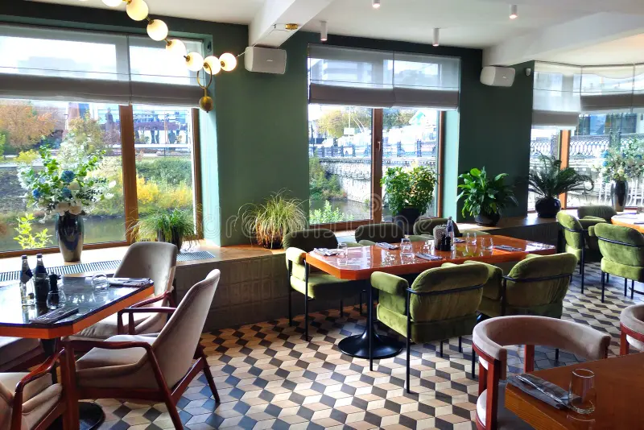
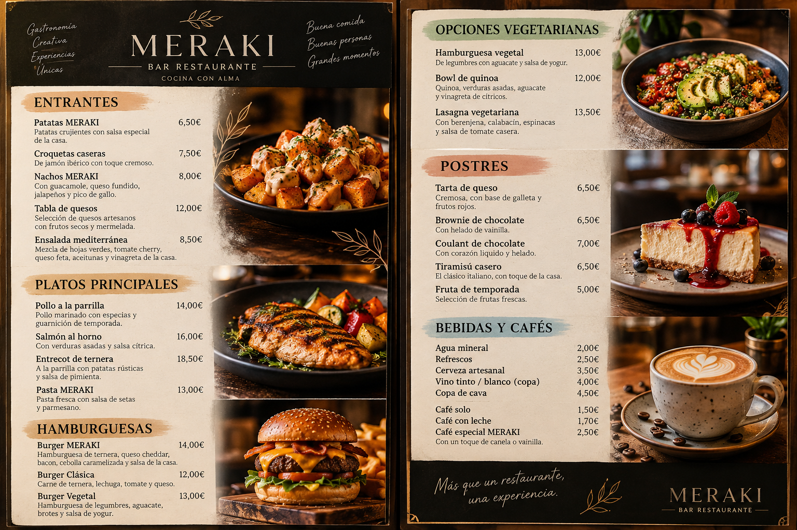
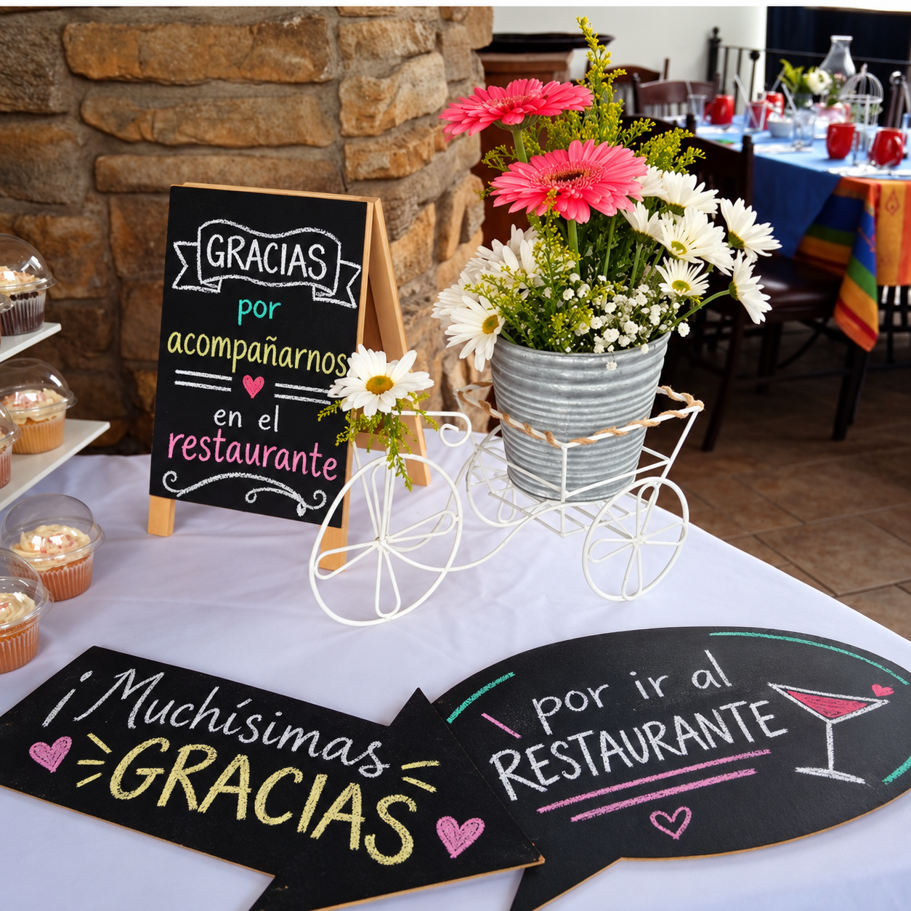

# Meraki¬ Bar Restaurante

binebenido a **Meraki**, un bar restaurante que teine una gastrononmia creativa y una pasion por los detalles que unen para ofrecer una experincia espcial a nustros clientes. En **Meraki** creemos que la cocina es una forma de expresion. Por eso, cada propueta busca transmitir una identidad propia y convertir cada visit en un momento memorarable.
## Nuestra Filosofía 
la filosofia de **Merki** consiste en trabajar con dedicación, cuidar la calidad de los ingrdinetes y ofrecer una experincia agradable a cada cliente.

Nuestros principales valores son:
* **calidad**: prestar atencion a lso ingredinetes y a su preparacion.
* **creatividad**: explotar nuevas combinaciones de sabores.
* **cercanias**: Ofercer una atencion amable y personalisada.
* **pasión**: cuidar los pequeños detlles de cada elaboración.

## nuestras propuesta gastronómicas

entre las categorias que puedan formar parte de nuestra oferta econtramos:
1. Entrantes para compartir.
2. Plstos principales elaborados con ingredientes de calidad.
3. Opciones vegetarianas.
4. Postres y propuestas dulces.
5. Bebidas y cafés.

### Siempre lo primeros

## Ejemplo de carta MERAKI
La siguiente tabla presenta una propuesta inicial
de platos para nuestro restaurante.

| Categoría | Producto | Descripción |
|---|---|---|
| Entrantes | Patatas MERAKI | Patatas con salsa especial |
| Hamburguesas | Burger MERAKI | Hamburguesa con ingredientes seleccionados |
| Platos principales | Pollo a la parrilla | Pollo acompañado de guarnición |
| Postres | Tarta de queso | Postre casero |
| Bebidas | Café especial | Café preparado al momento |

## Enlaces de interés
Para conocer más sobre el mundo de la gastronomía,
podemos consultar el siguiente enlace:

[Información sobre gastronomía](https://es.wikipedia.org/wiki/Gastronom%C3%ADa)

También podemos consultar nuestra documentación
complementaria:

[Ver información adicional de MERAKI](docs/detalles.md)

## 8. Conclusión

MERAKI es un proyecto gastronómico que busca
combinar creatividad, calidad y atención al cliente.

Esta documentación permite organizar la información
del restaurante mediante Markdown.

GitHub nos ayudará a almacenar los archivos
y mantener un control de versiones del proyecto.

En el futuro, esta documentación podrá servir
como punto de partida para desarrollar
la página web de MERAKI.

